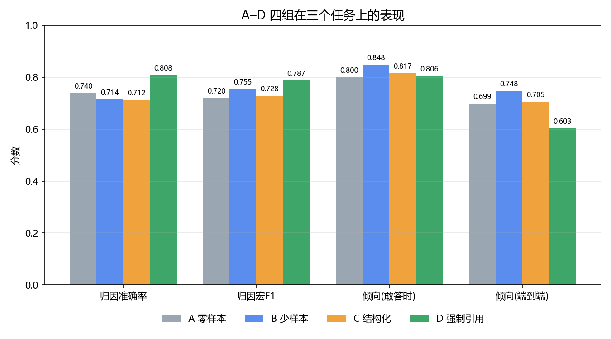

# 失眠社区文本 LLM 评测框架

对比 **4 种提示词策略** 与 **QLoRA 轻量微调** 在中文心理健康文本判断任务上的效果差异。

用同一批真实数据、同一个模型、同一套输出格式，只改变「怎么问」，量化不同方案在**准确率、依据可信度、成本**三个维度上的取舍。

---

## 主要结果

147 条人工标注测试集，6 组方案的横向对比：

| 组 | 方案 | 归因准确率 | 倾向 F1 | 拒答率 | 可核验率 | 幻觉率 | 输出 token |
|---|---|---|---|---|---|---|---|
| A | 零样本 | 0.740 | 0.747 | 28.8% | 42.3% | 42.4% | 56 /条 |
| B | 少样本 | 0.714 | 0.767 | 10.2% | 92.2% | 1.4% | 37 /条 |
| C | 结构化拆解 | 0.712 | 0.722 | 11.0% | 73.0% | 6.4% | **661 /条** |
| **D** | **强制引用原文** | **0.808** | **0.781** | 47.9% | **95.3%** | **0.0%** | 34 /条 |
| E | QLoRA 3 epoch | 0.547 | 0.000 | 0.0% | 80.3% | 10.2% | 30 /条 |
| E10 | QLoRA 10 epoch | 0.657 | 0.238 | 3.6% | 82.7% | 8.7% | 29 /条 |
| F | 微调 + 引用约束 | 0.578 | 0.000 | 23.7% | 80.2% | 15.0% | 29 /条 |



---

## 三个发现

### ① 强制引用能消灭幻觉，但要用覆盖率来换

要求模型「判断必须引用原文」后：

- 编造依据的比例：**42.4% → 0%**
- 依据可核验的比例：42.3% → **95.3%**
- 但拒答率：28.8% → **47.9%**

端到端的倾向判断准确率反而从 0.699 掉到 0.603——因为它一半的时候在说「无法判断」。

**这不是「哪个方案更好」的问题，是「你要哪种失败」的问题。**

### ② 结构化拆解提示词是白做的

把任务拆成一二三四步让模型逐项排查，结果：

| | 零样本 A | 结构化 C |
|---|---|---|
| 归因准确率 | 0.740 | 0.712（**无显著差异**，p=0.54） |
| 输出 token | 8,163 | **96,531（17.8 倍）** |
| 平均延迟 | 2.4 s | **13.4 s（9.6 倍）** |

**花了 18 倍的成本，换来的效果和什么都不加没有统计差异。**

### ③ 轻量微调打不过大模型的提示词工程

在 4GB 显存的笔记本上微调 Qwen2.5-1.5B：

- 3 epoch 时模型直接塌缩——正类 F1 = 0，从不输出「无法判断」
- 延长到 10 epoch（670 步）后改善到 F1 = 0.238
- 但归因准确率仍只有 0.657，**比最好的 API 方案低 15 个百分点**

**结论：179 条训练样本 + 1.5B 模型，在这个任务上还替代不了大模型 API。**

---

## 技术实现

### 数据采集：站点改版导致常规爬虫失效

百度贴吧 PC 版已改为**客户端渲染（CSR）**——HTML 里只有 `<div id="app"></div>`，`requests + BeautifulSoup` 拿到的是空壳。对应的 JSON 接口要求登录态（匿名返回 `error_code: 110001`）。

实际可行的方案：

```
有头 Edge 浏览器（headless 会被风控识别）
  + 持久化用户目录
  + 先访问 baidu.com 建立会话
  + 滚动加载（列表页懒加载，不滚动每页只有 10 帖）
```

### 数据清洗：正则规则抓不住中文科普文

关键词过滤对「把民法典全文粘在正文里」这类垃圾帖有效，但对中医科普、软广几乎无效。

改用**模型做相关性判定**（是否为发帖人本人的失眠叙事），识别出 **30.4% 的非用户内容**：

| 类型 | 条数 |
|---|---|
| 科普文献 | 73 |
| 广告软广 | 60 |
| 他人故事 | 11 |

### 模型选型：必须关掉「思考模式」

新版模型（Qwen3.7/3.8-Max 默认、DeepSeek v4 全系）大多是推理模型，有两个坑：

1. `max_tokens` 给小了会**静默返回空字符串**（预算全花在隐藏的思考上）
2. 推理模型的思考过程不可见、无法分析，却要按 token 付费

最终选定 **Qwen3.8-Max + `enable_thinking=False`**（2.5 s/次、72 token）与 **DeepSeek-V3.2**（天然非推理）。这是为了让 API 对照组和 1.5B 微调基座站在同一起跑线——否则 RQ2 比的就成了推理能力，而不是提示词方法。

### 4GB 显存上跑 QLoRA

| 参数 | 方案原定 | 实际采用 | 原因 |
|---|---|---|---|
| max_seq_len | 1024 | **512** | 768 即 OOM，峰值显存 2.96 GB |
| batch_size | 4 | 1 | 显存 |
| grad_accum | 4 | 8 | 保持等效 batch 8 |
| 训练数据 | 400 条 | 179 条 | 可用标注量 |

> ⚠️ 序列长度压到 512 后，完整提示词会把答案挤出窗口（tokenizer 默认右截断）。因此微调组改用精简提示词（`prompts/ft_compact.txt`），保留完整正文、牺牲指令篇幅。

---

## 快速开始

```bash
pip install -r requirements.txt

# 1. 采集（需要浏览器窗口，限速 1.5s/请求）
python scripts/crawl.py --kw 失眠 --pages 20

# 2. 清洗 + 相关性判定
python scripts/clean.py
python scripts/filter_gate.py
python scripts/apply_gate.py

# 3. 切分与标注
python scripts/make_splits.py
streamlit run scripts/label_tool.py

# 4. 一致性检验
python scripts/kappa.py

# 5. 构造 gold 与运行实验
python scripts/build_gold.py
python scripts/run_prompt_exp.py --provider qwen --groups A B C D

# 6. 评测与出图
python scripts/eval.py
python scripts/analyze.py
```

---

## 数据与伦理

**本仓库不包含原始语料。**

采集到的 661 条帖子是真实人群关于失眠与抑郁的自我陈述。公开分发既违反研究伦理，也可能给发帖人带来风险。因此：

- 原始数据、标注集、模型原始输出**均不纳入版本控制**（见 `.gitignore`）
- 仓库只保留代码、提示词模板、聚合指标与混淆矩阵
- 采集脚本已内置限速，不采集用户名，不构建用户画像

如果要用本框架复现，请自行运行采集脚本，并遵守同样的伦理约束。

---

## 目录结构

```
├── scripts/
│   ├── crawl.py              采集（CSR 页面 + 反爬处理）
│   ├── clean.py              规则清洗
│   ├── filter_gate.py        模型相关性判定
│   ├── make_splits.py        分层切分（固定 seed）
│   ├── label_tool.py         Streamlit 标注界面（含 evidence 实时校验）
│   ├── kappa.py              一致性检验 + 分歧清单
│   ├── build_gold.py         协商裁定生成 gold
│   ├── run_prompt_exp.py     A–D 提示词实验
│   ├── finetune_qlora.py     QLoRA 微调（4GB 适配）
│   ├── run_finetune_exp.py   微调模型推理
│   ├── eval.py               三类指标计算
│   └── analyze.py            汇总与出图
├── prompts/                  A–D 四版提示词 + 微调用精简版
├── labeling/标注手册.md       标注规范 v0.2（含边界规则）
└── outputs/                  结果表、混淆矩阵、图表
```

---

## 评测口径

报告任何指标必须带齐三样：**在哪个测试集上算的、什么协议算的、样本量多少**。

- **可核验引用产出率** = 合格的原文连续片段 / 全部输出片段
- **引用命中率** = 合格引用 / (合格引用 + 疑似编造)
- **幻觉率** = 疑似编造 / (合格引用 + 疑似编造)

其中「疑似编造」指长度 5–50 字但在原文中找不到的片段。**「无法判断」单独统计，不计入二分类分母**——模型拒答和模型判错是两回事。

---

## License

MIT
